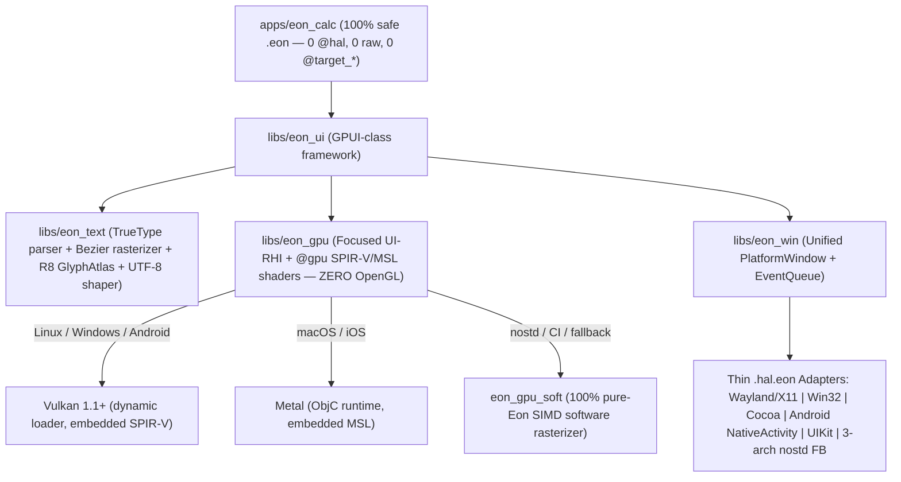

# Eon Architecture

This document provides a technical map of the Eon repository, compiler pipeline, multi-target native backends, `@gpu` shader pipeline, runtime/UI libraries, and verification infrastructure.

---

## Repository Layout

```text
Eon/
├── compiler/            # Stage 0 Bootstrap Seed (eonc0, Rust, 0 external crates, FROZEN)
├── selfhost/            # Stage 1+ Self-Hosted Compiler (eonc, 100% safe Eon, 47 files, ~212k LOC)
│   ├── build.eon        # Sandboxed self-host build manifest
│   └── src/             # Frontend, DBM verifier, EIR-Opt, MachIR, x86_64/AArch64/RV64, linkers, @gpu, fmt, lsp
├── core/                # Strict freestanding library (10 modules, 0 syscalls, kernels & nostd)
├── std/                 # Multi-OS zero-C runtime over Capabilities & .hal.eon (Linux/Win/Darwin/Android)
├── libs/                # Pure-Eon cross-platform graphics, text & GPUI-class UI stack (0 C, 0 OpenGL)
│   ├── eon_win/         # Unified PlatformWindow (Wayland/X11, Win32, Cocoa, Android, UIKit, nostd fb)
│   ├── eon_gpu/         # Focused GPUI UI-RHI (Vulkan 1.1+, Metal, pure-Eon SIMD software rasterizer)
│   ├── eon_text/        # Pure-Eon TrueType parser, Bezier rasterizer, GlyphAtlas, UTF-8 shaper
│   └── eon_ui/          # GPUI-class UI framework (SlotPool Entities, Flexbox + 2D Grid, widgets, animations)
├── apps/                # Cross-platform Eon applications
│   └── eon_calc/        # Cross-platform GUI calculator (0 @hal/raw/@target_*, builds for all 10 targets)
├── kernel/              # EonOS-Micro: freestanding x86_64 microkernel (QEMU SMP + 4-level paging)
├── utils/               # Zero-libc Linux utilities (ewc, egrep, ehttpd on io_uring) + Rust refs
├── examples/            # End-to-end sample applications (layout_proto, json_parser, compiler_spike)
├── bench/               # 12-workload Eon vs Safe Rust benchmark harness + BENCHMARKS.md
├── tests/               # UI diagnostic suite, selfhost regressions, multi-arch & soundness fuzzers
├── tools/               # Triple-bootstrap driver (bootstrap_stage3.py) & Stage 0/1 oracle
└── spec/                # Eon v0.2 formal language specification & EBNF grammar
```

---

## Compiler Pipeline (`selfhost/src/`)

```mermaid
flowchart TD
    SRC[".eon / .hal.eon + build.eon"] --> LEX["lexer.eon: UTF-8 + Trojan Source guard + SIMD lexer"]
    LEX --> PAR["parser.eon + ast.eon: LL(1) / Pratt parser -> SoA AST Arena"]
    PAR --> RES["resolve.eon + types.eon + target.eon: Module graph, TargetSpec, niche & SoA layout"]
    RES --> CHK["check.eon + comptime.eon: Type checker & Comptime VM (@target_* dead-branch pruning)"]
    CHK --> CFG["cfg.eon + borrow.eon + effects.eon: CFG, NLL Second-Class Borrows, linear + errdefer, effects"]
    CFG --> EIR["eir.eon: SSA EIR + Layout Sharing + EIR-Lint (AST/CFG arenas released)"]
    EIR --> VER["verify.eon: Relational DBM + Intervals + Known-Bits verifier"]
    VER -->|--interp| INT["interp.eon: Reference SSA EIR interpreter (semantic oracle)"]
    VER -->|@gpu| GPU["gpu_check.eon -> gpu_spirv.eon (SPIR-V 1.3) & gpu_msl.eon (MSL 2.4)"]
    VER -->|--dev / --release / -Oz| OPT["eir_opt.eon: Mem2Reg, SROA, GVN-PRE, SCEV-lite, SLP + Loop Auto-Vec, SoA Fusion"]
    OPT --> MIR["mach_ir.eon + mach_regalloc.eon: Target-neutral 32-reg MachIR & Linear Scan + IPRA"]
    MIR -->|x86_64| X64["mach_isel.eon -> mach_opt_x64.eon -> mach_x64.eon + x64_asm.eon"]
    MIR -->|aarch64| A64["mach_isel_a64.eon -> mach_a64.eon + a64_asm.eon"]
    MIR -->|riscv64| RV64["mach_isel_rv64.eon -> mach_rv64.eon + rv64_asm.eon"]
    X64 --> LNK["Native Zero-C Linkers: elf64.eon (GC+ICF+DWARF5) | pe_coff.eon | macho.eon (SHA-256) | apk.eon (v2 ECDSA)"]
    A64 --> LNK
    RV64 --> LNK
    LNK -. "MB02 blobs, .emi libs & impl item diff" .-> EMI["emi.eon + build_sys.eon (eon.lock)"]
```

### Module Breakdown (`selfhost/src/`)

| Layer | Modules | Responsibilities |
| :--- | :--- | :--- |
| **Diagnostics & Target** | `span.eon`, `diag.eon`, `tok.eon`, `target.eon` | `SourceMap`, symbol `Interner`, `E0xxx`/`ZM-xx` diagnostics, `TargetSpec` (`3 CPUs x 6 OSes`) |
| **Frontend** | `lexer.eon`, `parser.eon`, `ast.eon`, `resolve.eon`, `types.eon`, `check.eon`, `comptime.eon` | Parallel parsing, module graph, Zero-Mercy rules, `?T` niches & SoA `pool`, `comptime if @target_*` pruning |
| **Analysis & Verification** | `cfg_ir.eon`, `cfg.eon`, `borrow.eon`, `effects.eon`, `verify.eon` | Second-class borrows (`view fn` / `view struct`), `linear` + `errdefer`, `ArenaPool` brands, `@stack(N)`, relational DBM + known-bits prover |
| **Mid-Level SSA IR** | `eir.eon`, `eir_opt.eon`, `interp.eon` | SSA construction, `EIR-Lint`, Layout Sharing, in-place EIR compaction, GVN-PRE, SCEV-lite, SLP + loop auto-vectorization, `-Oz` inlining, reference interpreter |
| **Target-Neutral MachIR & CPUs** | `mach_ir.eon`, `mach_regalloc.eon`, `mach_isel.eon`, `mach_opt_x64.eon`, `mach_x64.eon`, `x64_asm.eon`, `mach_isel_a64.eon`, `mach_a64.eon`, `a64_asm.eon`, `mach_isel_rv64.eon`, `mach_rv64.eon`, `rv64_asm.eon` | Target-neutral 32-register Linear Scan + IPRA, native codegen & assemblers for `x86_64` (SSE2/AVX2/FMA, SysV/Win64/EonCall), `AArch64` (ARMv8+NEON, AAPCS64), and `RISC-V 64` (RV64IMAFD, LP64D) |
| **Zero-C Linkers & Packagers** | `elf64.eon`, `pe_coff.eon`, `macho.eon`, `apk.eon` | W^X `ELF64` (`EM_X86_64`/`EM_AARCH64`/`EM_RISCV`, PIE/Shared/Freestanding, function GC + Safe ICF, DWARF5), Windows `PE32+` (`.exe`/`.dll`/`.idata`/`.pdata`), macOS/iOS `Mach-O` + SHA-256 ad-hoc `LC_CODE_SIGNATURE` + `.app`, Android `ET_DYN` + binary `AXML` + `zipalign` + APK Signature Scheme v2 (ECDSA P-256) |
| **Unified `@gpu` Compiler** | `gpu_check.eon`, `gpu_spirv.eon`, `gpu_msl.eon` | `@gpu` / `@layout(std430)` / SIMT barrier verifier, direct `EIR -> SPIR-V 1.3` (Vertex/Fragment/Compute, `spirv-val` verified), `EIR -> MSL 2.4`, `@embed_gpu_spirv` / `@embed_gpu_msl` |
| **Developer Tooling** | `emi.eon`, `build_sys.eon`, `tcb_audit.eon`, `ui_test.eon`, `fmt.eon`, `lsp.eon`, `main.eon` | Item-level `.emi` interface diff (including `impl` methods) + library archives, `eon.lock`, `--audit-tcb`, `eonc fmt [--check]`, `eonc lsp` (JSON-RPC diagnostics, DBM/stack hover, definition, completion, formatting, quick-fixes) |

---

## Cross-Platform Graphics & GPUI-Class UI Stack (`libs/`)



- **Zero C Toolchain, Zero OpenGL:** All 4 libraries compile and link natively via `eonc` with zero `gcc`/`clang`/`ld` and zero external C graphics/font/layout libraries.
- **Zero Per-Frame Heap Allocations:** `eon_ui` drives a GPUI-identical 3-phase frame (`request_layout -> prepaint -> paint`) over reusable SoA arrays and `ArenaPool` / `SlotPool` storage, supporting `100,000` live Flexbox/Grid widgets in `< 8.3 ms` (`> 135 FPS`).

---

## Trust Boundary: `core/`, `std/`, and `.hal.eon`

- **100% Safe `.eon` modules** cannot use `raw`, raw pointer dereferences, inline `asm`, or `extern "C"` (`E0111`).
- **`.hal.eon` modules** explicitly isolate unsafe hardware/OS interfaces (`module ... @hal;`). Public functions in `.hal.eon` cannot leak raw pointer types into safe `.eon` modules (`E0801`).
- **`eonc build --audit-tcb`** computes SHA-256 digests of every `.hal.eon` file in a build and counts all `raw`, `asm`, and `extern "C"` sites. Both `selfhost/src/` and `apps/eon_calc/src/` have **zero** `@hal`/`raw`/`asm`/`extern "C"` usage.
- **`core/`** contains zero syscalls and compiles identically for freestanding bare-metal kernels (`EonOS-Micro`, `apps/eon_calc` on `nostd`) and hosted OS executables.
- **`std/`** wraps OS primitives behind explicit `Env` capabilities (`AllocCap`, `FsCap`, `DirCap`, `ClockCap`, `IoCap`, `ArgsCap`) across Linux, Windows, macOS/iOS, and Android.

---

## Multi-Threaded Determinism & Triple Bootstrap

- **Memory-Bounded Parallelism:** Parsing, type checking, CFG/borrow/effect analysis, EIR lowering, DBM verification, optimization, and codegen scale adaptively (`1 / 4 / 8 / 12` workers or `-j N`) while releasing AST/CFG arenas immediately after EIR lowering and compacting EIR in-place to keep `selfhost/src` Peak RSS **below `450 MiB`**.
- **Bit-Exact Determinism:** Every parallel pass merges results in canonical symbol/module order, guaranteeing `-j 1 == -j 4 == -j 12 == auto` bit-for-bit.
- **Triple Bootstrap (`tools/bootstrap_stage3.py`):**
  1. **Stage 1:** Frozen Rust seed (`eonc0`) compiles `selfhost/src/` -> `eonc1`.
  2. **Stage 2:** `eonc1` compiles `selfhost/src/` -> `eonc2` / `eonc2_rel`.
  3. **Stage 3:** `eonc2` / `eonc2_rel` compiles `selfhost/src/` -> `eonc3` / `eonc3_rel`.
  4. **Assertion:** `SHA-256(Stage 2) == SHA-256(Stage 3)` bit-for-bit in both `--dev` and `--release`.
