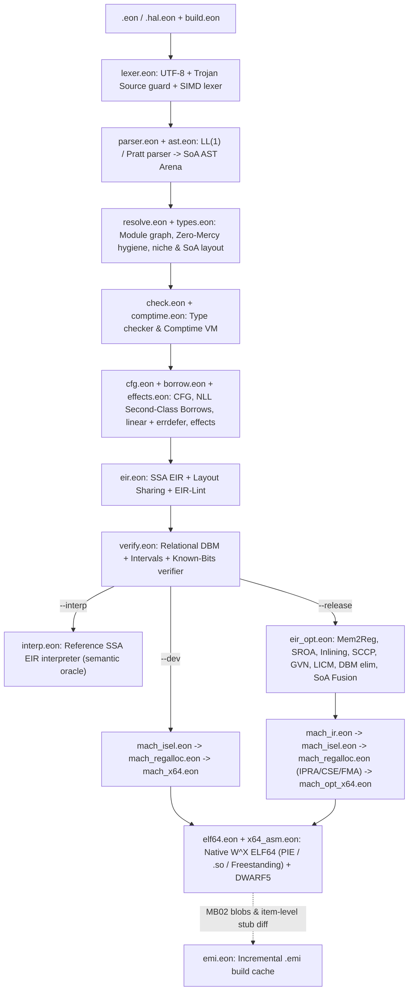

# Eon Architecture

This document provides a technical map of the Eon repository, compiler pipeline, runtime layers, and verification infrastructure.

---

## Repository Layout

```text
Eon/
├── compiler/            # Stage 0 Bootstrap Seed (eonc0, Rust, 0 external crates, frozen)
├── selfhost/            # Stage 1+ Self-Hosted Compiler (eonc, 100% safe Eon, ~171k LOC)
│   ├── build.eon        # Sandboxed self-host build manifest
│   └── src/             # 30 compiler modules (frontend, middle, optimizer, backend, linker)
├── core/                # Strict freestanding library (0 syscalls, usable in kernels & nostd)
├── std/                 # Linux x86_64 zero-libc runtime over Capabilities & @hal
├── kernel/              # EonOS-Micro: freestanding x86_64 microkernel (QEMU SMP + paging)
├── utils/               # Zero-libc Linux utilities (ewc, egrep, ehttpd on io_uring) + Rust refs
├── examples/            # End-to-end sample applications (layout_proto, json_parser, compiler_spike)
├── bench/               # 12-workload Eon vs Safe Rust benchmark harness + BENCHMARKS.md
├── tests/               # UI diagnostic suite (88+ tests), selfhost regressions, fuzzers
├── tools/               # Triple-bootstrap driver (bootstrap_stage3.py) & Stage 0/1 oracle
└── spec/                # Eon v0.2 formal language specification & EBNF grammar
```

---

## Compiler Pipeline (`selfhost/src/`)



### Module Breakdown (`selfhost/src/`)

| Layer | Modules | Responsibilities |
| :--- | :--- | :--- |
| **Diagnostics & Spans** | `span.eon`, `diag.eon`, `tok.eon` | `SourceMap`, deterministic symbol `Interner`, `E0xxx` / `ZM-xx` diagnostic rendering |
| **Frontend** | `lexer.eon`, `parser.eon`, `ast.eon`, `resolve.eon`, `types.eon`, `check.eon`, `comptime.eon` | Parallel multi-file parsing, module graph, Zero-Mercy rules, niche `?T` & SoA `pool` layout, `comptime` evaluator |
| **Analysis & Verification** | `cfg_ir.eon`, `cfg.eon`, `borrow.eon`, `effects.eon`, `verify.eon` | Second-class borrows (`view fn` / `view struct`), `linear` + `errdefer`, `ArenaPool` brands, effect & `@stack(N)` analysis, relational DBM + known-bits prover |
| **Mid-Level SSA IR** | `eir.eon`, `eir_opt.eon`, `interp.eon` | SSA construction, `EIR-Lint`, Layout Sharing generics, `--release` SSA optimization passes, reference semantic interpreter |
| **Backend & Linker** | `mach_ir.eon`, `mach_isel.eon`, `mach_regalloc.eon`, `mach_opt_x64.eon`, `mach_x64.eon`, `x64_asm.eon`, `elf64.eon` | Target-oriented MachIR, DAG ISel, Linear Scan RegAlloc + IPRA + reg-mem spill folding + FMA fusion, peephole/scheduling, AVX2/SIB encoder, W^X ELF64 linker (`ET_DYN` PIE, `.so`, freestanding Multiboot2/PVH), DWARF5 |
| **Tooling & Incremental** | `emi.eon`, `build_sys.eon`, `tcb_audit.eon`, `ui_test.eon`, `main.eon` | Item-level `.emi` interface diff & function blob cache (`MB02`), sandboxed `build.eon`, `--audit-tcb`, parallel UI test runner, adaptive MT driver |

---

## Trust Boundary: `core/`, `std/`, and `.hal.eon`

- **100% Safe `.eon` modules** cannot use `raw`, raw pointer dereferences, inline `asm`, or `extern "C"` (`E0111`).
- **`.hal.eon` modules** explicitly isolate unsafe hardware/OS interfaces (`module ... @hal;`). Public functions in `.hal.eon` cannot leak raw pointer types into safe `.eon` modules (`E0801`).
- **`eonc build --audit-tcb`** computes SHA-256 digests of every `.hal.eon` file in a build and counts all `raw`, `asm`, and `extern "C"` sites. `selfhost/src/` itself has **zero** `@hal`/`raw`/`asm`/`extern "C"` usage.
- **`core/`** contains zero syscalls and compiles identically for freestanding kernels (`EonOS-Micro`) and hosted Linux executables.
- **`std/`** wraps Linux `x86_64` primitives (`_start`, `vDSO`, TLS slab allocator, `clone`/`futex` scheduler, `io_uring`, `openat2(RESOLVE_BENEATH)`) behind explicit `Env` capabilities (`AllocCap`, `FsCap`, `DirCap`, `ClockCap`, `IoCap`, `ArgsCap`).

---

## Multi-Threaded Determinism & Triple Bootstrap

- **Parallel Passes:** Parsing, type checking, CFG lowering, borrow checking, effect checking, EIR lowering, DBM verification, EIR linting, EIR optimization, and x86_64 MachIR codegen all scale adaptively (`1 / 4 / 8 / 12` workers based on workload size, or explicit `-j N`).
- **Bit-Exact Determinism:** Every parallel stage partitions deterministically and merges outputs in canonical symbol/module order, guaranteeing `-j 1 == -j 4 == -j 12 == auto` (verified across both `--dev` and `--release`).
- **Triple Bootstrap (`tools/bootstrap_stage3.py`):**
  1. **Stage 1:** Frozen Rust seed (`eonc0`) compiles `selfhost/src/` -> `eonc1`.
  2. **Stage 2:** `eonc1` compiles `selfhost/src/` -> `eonc2` / `eonc2_rel`.
  3. **Stage 3:** `eonc2` / `eonc2_rel` compiles `selfhost/src/` -> `eonc3` / `eonc3_rel`.
  4. **Assertion:** `SHA-256(Stage 2) == SHA-256(Stage 3)` bit-for-bit in both `--dev` and `--release`.
