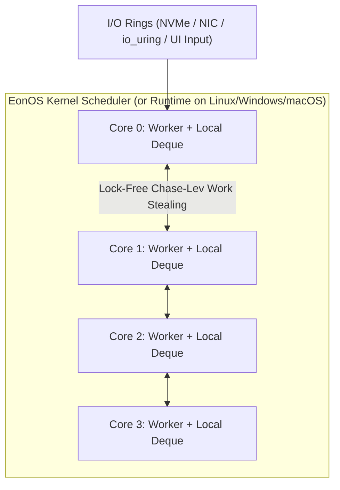

# 06. Concurrency, Data Parallelism, and Formal Memory Model

This chapter establishes two foundational principles of Eon:
1. **In application code, UI, and upper OS layers:** no global variables and no mutexes — parallelism is expressed declaratively through `sys` (a graph of pool columns) and `par for` (per-element isolation) on top of a **"1 worker thread = 1 physical CPU core"** system scheduler.
2. **In the OS kernel and drivers (`@hal`):** a strict, cross-architecture model of atomics and memory barriers guaranteeing correctness on both strong memory models (`x86_64` TSO) and weak models (`ARM64`, `RISC-V`).

---

## 1. Prohibition of Shared Mutable State (`ZM-10`)

* Module-level mutable variables are **physically forbidden** in Eon (`var` outside a function is error `E0110`, even in `.hal.eon`).
* Only immutable `const` declarations are permitted (evaluated at `comptime` and placed in the `.rodata` segment).
* Consequence: all state in a program enters a function **explicitly through parameters**. From this, the compiler knows the **complete set of memory** that a function is capable of reading or modifying.

---

## 2. Systems (`sys`) and Automatic Lock-Free Subsystem Parallelism

The `sys` keyword declares a unit of parallel scheduling with explicit access partitioning over pool columns (`read` / `write`):

```
pub sys calc_layout(
    parents: read  ArenaPool[Widget].parent,
    bounds:  write ArenaPool[Widget].{pos, size},
) {
    // ...
}

pub sys animate_colors(
    styles: read  ArenaPool[Widget].flags,
    colors: write ArenaPool[Widget].color,
    dt:     f32,
) {
    // ...
}
```

### 2.1. System Graph Scheduling Rules (`Schedule`)
When assembling a UI frame or an OS scheduler step, systems are registered in a static `Schedule` graph:
```
let frame_graph = comptime Schedule.build(.{
    calc_layout,
    animate_colors,
    build_draw_list,
});
```
At **`comptime`**, the compiler builds a conflict graph over `(PoolType, ColumnName)` pairs:
* `read` + `read` on the same column -> **no conflict**; executed **simultaneously on different CPU cores**.
* `write` on column `A` + `write` on column `B` (where `A != B`, e.g., `Widget.{pos, size}` and `Widget.color`) -> **no conflict**; executed **simultaneously without mutexes and without false sharing** (columns are aligned to 64-byte cache lines!).
* `write` on column `X` + `read` or `write` on the same column `X` -> the compiler establishes a strict ordering edge (stage barrier). If the programmer has not explicitly specified an ordering (`before`/`after`) between two conflicting `sys` declarations — **compile error `E0601`** (preventing non-deterministic frame order!).

---

## 3. Parallel Loops (`par for`) and Intra-Pool Race Protection

Fine-grained data parallelism is written with `par for`:
```
par for row in bounds.each_mut() {
    row.pos = row.pos + f32x2.{ 1.0, 0.0 };
}
```

### 3.1. Solving Aliasing Inside `par for` (Disjoint Element Access)
To completely eliminate data races such as `out.pos[id] = out.pos[parent] + offset` inside a parallel loop:

1. **The `each_mut()` / `each()` iterator provides isolated access to a single row:**
   Inside the `par for` body, the source pool/slice `bounds` is **locked** (inaccessible under the name `bounds`!). Write access is permitted **exclusively** through the iteration variable `row` (a second-class reference to exactly one disjoint element/index belonging to the current worker).
2. **External data captured by the `par for` body must be strictly immutable (`read` / `*T` / `TrivialCopy`):**
   Attempting to capture a `*mut` variable or mutate an outer `var` inside `par for` is a **hard compile error `E0602`**.
3. **How to implement hierarchies/neighbors (e.g., `pos[id] = pos[parent] + offset`) without races:**
   - **Approach A (Double Buffering / Snapshot):** read parents from an immutable previous-step buffer `prev_pos: read Pool[Widget].pos` and write into `next_pos: write Pool[Widget].pos`. 100% parallel and 0 races.
   - **Approach B (Sequential Topological Pass):** use a regular `for` over tree depth layers (UI tree depth is typically `<= 16`, and each individual depth level can itself be processed with `par for`!).
4. **Reductions (`par_reduce`):** a regular iterator method `it.par_reduce(op, init)` (not special syntax). Only operations whose result **depends neither on core count nor on execution order** are permitted (associativity of a user-defined `op` cannot be verified, so custom `op` functions are not accepted):
   * integers: `.AddWrap`, `.Min`, `.Max`, `.And`, `.Or`, `.Xor`;
   * `f32` / `f64`: `.Min`, `.Max` (`NaN` ordered by `total_cmp`), and `.AddTree` — summation over a **fixed binary tree** of chunks of size `@chunk(N)` (default 256), ordered by index. The tree shape depends only on data length and `N`, not on the number of cores, so the result is **bit-for-bit identical on every machine**. Plain `+` on `f32` is rejected in reductions (`E0603`), since it would yield different results under different core counts.
   Each core accumulates its chunk totals in registers, and folding proceeds up the same tree in `O(log n)`.

### 3.2. Adaptive Zero-Overhead Degradation (Zero-Overhead Threshold)
The compiler and scheduler **never parallelize tiny workloads**:
* Every `par for` has a minimum chunk threshold (by default `>= 256` elements or `>= 4 KB` of processed data, configurable via `@chunk(N)`).
* If `len < threshold` **or** all other CPU cores are currently busy with other tasks, `par for` executes immediately on the **current core as a flat SIMD loop** with zero cache-synchronization overhead!

---

## 4. Execution Model: "1 Worker Thread = 1 Physical CPU Core"



* At program startup (or EonOS kernel boot), exactly **one worker thread per available physical CPU core** is created with hard CPU affinity. No thread oversubscription and no unnecessary context switches!
* **Task hierarchy:**
  1. **`sys` graph** (coarse-grained independent stages).
  2. **`par for` chunks** (split lazily via a lock-free Chase-Lev work-stealing deque; local push/pop executes in ~5 cycles with no atomics on the hot path).
  3. **I/O fibers** (detailed in [07-effects-capabilities-io.md](07-effects-capabilities-io.md)) — cooperatively yield the core while waiting on disk or network I/O.
* **Layer separation in the OS kernel:** at the lowest level of kernel boot (prior to scheduler startup and inside `@interrupt`), scheduler multithreading is not used — each physical core is represented by an explicit `CpuCore` object with its own per-CPU data structures.

---

## 5. Formal Memory Model, Atomics, and DMA Barriers

Eon's memory model is based on the formal axiomatic **C++20 / Rust model (DRF-SC: Data-Race-Free implies Sequential Consistency)** with two critical strengthenings:
1. **No non-atomic data races at all** in `.eon` (statically impossible).
2. **Explicit hardware DMA/MMIO barriers** for OS drivers on weakly ordered architectures (`ARM64`, `RISC-V`).

### 5.1. The `Atomic[T]` Type
Permitted `T`: `bool`, `u8`, `u16`, `u32`, `u64`, `usize`, `i8..i64`, `isize`, `PhysAddr`, `VirtAddr` (strictly types supported lock-free in hardware on the target architecture; otherwise compile error `E0610` — hidden spinlocks inside `Atomic` **do not exist** in Eon!).

Memory orderings (`enum Ordering : u8`):
* `.Relaxed` — atomicity of the operation only, with no ordering guarantees (statistics counters, ID generation).
* `.Acquire` — forbids reordering subsequent loads/stores *above* this load (spinlock acquisition, reading a producer index).
* `.Release` — forbids reordering preceding loads/stores *below* this store (spinlock release, publishing an entry to a ring buffer).
* `.AcqRel` — combines `Acquire` + `Release` for RMW operations (`fetch_add`, `compare_exchange`).
* `.SeqCst` — a single global total order across all `SeqCst` operations.

### 5.2. Target CPU Architecture Mapping (Backend Obligations)

| Eon Operation | `x86_64` (TSO) | `ARM64` (AArch64 v8.1+ LSE) | `RISC-V` (`RV64A` + Ztso/RVWMO) |
| :--- | :--- | :--- | :--- |
| `load(.Acquire)` | `mov` (compiler barrier) | `ldar` | `ld; fence r, rw` |
| `store(.Release)` | `mov` (compiler barrier) | `stlr` | `fence rw, w; sd` |
| `store(.SeqCst)` | `xchg` or `mov; mfence` | `stlr` | `fence rw, rw; sd; fence rw, rw` |
| `fetch_add(.AcqRel)` | `lock xadd` | `ldaddal` | `amoadd.d.aqrl` |
| `cas(.AcqRel)` | `lock cmpxchg` | `casal` | `lr.d.aq / sc.d.rl` loop |
| `cpu_relax()` | `pause` | `yield` / `isb` | `pause` (Zihintpause) |

### 5.3. Linear Spinlock in the OS Kernel (Impossible to Forget `unlock`!)
```
// Module core.sync is declared @hal: only a HAL module may store rawptr in a struct.
pub linear struct SpinGuard[T] {
    lock: rawptr_mut[SpinLock[T]];   // NOT `*mut`: a second-class reference cannot be stored in a struct (E0310)
}
```
Only safe methods are exposed externally (`E0801`): `view fn get_mut(self: *mut Self) -> *mut T` and `fn unlock(self: SpinGuard[T])` (consumes the token).
In EonOS, acquiring a spinlock returns a **linear token** `SpinGuard`:
* Forgetting to release the spinlock (even along an error path via `try`!) is **physically impossible** (`ZM-09`!).
* Acquiring a kernel spinlock (`IrqSpinLock`) automatically raises the `@noblock` effect — the compiler **forbids** calling any sleeping or allocating function, or acquiring a second blocking resource, while `IrqGuard` is alive!

### 5.4. Cache and DMA Barriers (for `.hal.eon` Drivers)
On `ARM64` and `RISC-V`, devices (NVMe, NICs, GPUs) are often not cache-coherent with the CPU. `core.hal.dma` defines explicit operations that compile to `no-op` on coherent `x86_64` and to exact cache-line clean/invalidate instructions on `ARM64`/`RISC-V`:
* `dma_barrier_to_device(buf: *DmaBuf)` — `dc cvac; dsb sy` (ARM64) / `cbo.clean; fence rw, o` (RISC-V).
* `dma_barrier_from_device(buf: *mut DmaBuf)` — `dc ivac; dsb sy` (ARM64) / `cbo.inval; fence i, rw` (RISC-V).
* `mmio_barrier()` — strict ordering barrier for uncacheable device memory.

---

## 6. Specification Tests

### Must Compile
```
module example.concurrency_ok;

pub pool Particle {
    pos: f32x2;
    vel: f32x2;
}

pub sys integrate(
    vel: read  ArenaPool[Particle].vel,
    pos: write ArenaPool[Particle].pos,
    dt:  f32,
) {
    let dt_vec = f32x2.splat(dt);
    par for (p, v) in pos.each_mut_with(vel) {
        p.* = p.* + (v.* * dt_vec); // 0 races, 0 mutexes, auto-SIMD + work-stealing!
    }
}
```

### Must Fail Compilation
```
module example.concurrency_fail;

var GLOBAL_COUNTER: u64 = 0_u64; // ERROR E0110 (ZM-10): global var is forbidden!

pub fn bad_par(xs: *mut [u32]) {
    var total: u32 = 0_u32;
    par for x in xs.each_mut() {
        total = total +% *x;     // ERROR E0602: mutating an outer variable inside par for!
    }
}
```
