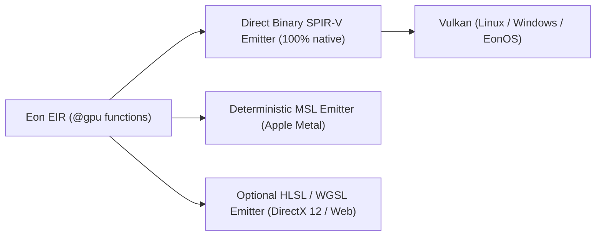

# 08. `@hal` Modules, Hardware Access, C FFI, and the `@gpu` Model

This chapter defines the strict boundary between the safe `.eon` world and the external untyped world (CPU hardware, MMIO registers, C libraries of foreign operating systems, and GPU accelerators).

---

## 1. Isolating Unsafe Operations: `.hal.eon` Modules

Eon has **no** `unsafe` keyword in regular `.eon` files.
All work with raw memory addresses, inline assembly, `volatile` registers, and the C ABI is permitted **exclusively** in files with the `.hal.eon` extension and the module header:
```
module kernel.arch.x86_64.apic @hal;
```

### 1.1. Constructs Permitted ONLY Inside `.hal.eon`
1. **The `raw { ... }` block:** inside this block (and only inside it), the following are permitted:
   - dereferencing raw pointers `rawptr[T]` and `rawptr_mut[T]`;
   - creating a raw pointer from `PhysAddr` / `VirtAddr`;
   - inline assembly `asm(...)`;
   - accessing `volatile` / `MmioReg`;
   - calling `extern "C"` functions;
   - constructing a safe slice `*[T]` / `*mut [T]` from `(rawptr, len)` and minting a linear resource (`PhysPage`) after validating invariants.
2. **Prohibition against leaking `raw` types outward:**
   The compiler forbids a public function `pub fn` in `.hal.eon` from taking or returning `rawptr[T]` (`E0801`), unless the calling module is itself `@hal`. Only **safe typed abstractions** (`PhysPage`, `MmioWindow`, `WindowHandle`, `GpuDevice`) are exported outward into the `.eon` world.
3. **TCB (Trusted Computing Base) Audit:**
   The build system command `eon build --audit-tcb` prints the exact list of all `.hal.eon` files in the project along with their SHA-256 checksums. A third-party library **cannot** contain `.hal.eon` files unless the user explicitly permits it in the trusted allowlist in `build.eon` (`allow_hal = [...]`) — completely blocking hidden supply-chain attacks through dependencies!

---

## 2. Typed Hardware Primitives and `arch/` Layout

### 2.1. Typed MMIO Registers (`MmioReg`)
In C, bitfields and `volatile` frequently compile down to the wrong bus access width (for example, an 8-bit read instead of a mandatory 32-bit read), hanging a PCIe/NVMe controller.
In Eon, MMIO registers are typed by their **permitted operations** and **strict bus transaction width**:
```
module kernel.arch.x86_64.apic @hal;

pub struct ApicRegs {
    id:  MmioReg[u32, .ReadOnly]      @offset(0x020);
    eoi: MmioReg[u32, .WriteOnly]     @offset(0x0B0);
    svr: MmioReg[SvrBits, .ReadWrite] @offset(0x0F0);
    isr: MmioReg[u32, .Write1ToClear] @offset(0x100);
}
```
* Attempting to read a `.WriteOnly` register (such as `apic.eoi`) or write to a `.ReadOnly` register is a **compile error `E0805`**!
* The compiler guarantees generation of **exactly one** uncached instruction matching the width of the underlying type (`mov dword ptr` on `x86_64`, `ldr w` / `str w` on `ARM64`, `lw` / `sw` on `RISC-V`) without splitting into byte accesses and without eliding duplicate writes.

### 2.2. Inline Assembly (`asm`) and Naked Functions
* `@naked` — a function emitted without compiler prologue/epilogue (for bootloader entry points, fiber context switches, and interrupt vectors).
* `asm("mov %cr3, $0", out(reg) val)` — a typed assembly template with explicit lists of inputs, outputs, and clobber registers (like Rust's `asm!`, but without macros).
* Assembly validation is built directly into the compiler's target backend (`x86_64` / `ARM64` / `RISC-V`) — no external `gas`/`nasm` is required.

### 2.3. OS Kernel Portability (`arch/`)
98% of the OS kernel (scheduler, VFS, network stack, IPC, allocators, compositor) is written in portable `.eon` modules. CPU-specific code is isolated to ~2% of the codebase under `arch/`:
```
kernel/
├── arch/
│   ├── x86_64/   (GDT/IDT, APIC, 4/5-level paging, syscall/sysret, boot.hal.eon)
│   ├── arm64/    (EL1/EL2, GICv3, TTBR0/1, PSCI, boot.hal.eon)
│   └── riscv64/  (S-mode, PLIC/CLINT, Sv39/Sv48, SBI, boot.hal.eon)
└── core/         (100% shared code across all architectures)
```
Implementation selection is performed through a unified interface and `comptime if @target_arch() == ...`.

---

## 3. C Interoperability (C FFI)

So that Eon applications and the UI engine run 1-for-1 on **Windows**, **Linux**, and **macOS**, the platform layer (`platform/{linux,windows,macos}/*.hal.eon`, ~2,000 lines per platform) interfaces with Win32, POSIX/Linux syscalls, Vulkan, and Cocoa/Metal via C FFI:

```
module platform.win32.mem @hal;

extern "C" struct SystemInfo {
    oem_id: u32;
    page_size: u32;
    // strict C layout and alignment for the target ABI
}

extern "C" fn VirtualAlloc(
    addr: rawptr_mut[void],
    size: usize,
    alloc_type: u32,
    protect: u32,
) -> ?rawptr_mut[void];
```

### 3.1. Callbacks from C to Eon (e.g., `WndProc` on Windows)
Two distinct mechanisms have similar syntax: **`extern "C" fn …;`** (keyword, no body) *imports* a C symbol; **`@extern("C")`** (attribute on a `fn` with a body) *exports* an Eon function with the C ABI. An Eon function passed into a C library is annotated with **`@extern("C")`**:
* The compiler generates the target platform's standard C ABI prologue/epilogue (System V AMD64 / Win64 / AAPCS64).
* Returning Eon-specific types (`T ! E`, `*[T]`, `linear`) across an `@extern("C")` boundary is forbidden (`E0810`) — only C-compatible scalars, `extern "C" struct`, and `rawptr` are allowed.
* **Error isolation at the FFI boundary:** inside an `@extern("C")` function, every Eon error must be explicitly converted into a C return code (no `try` propagation out into C).

---

## 4. GPU Programming Model (`@gpu`)

Eon lets you write CPU UI-engine logic and GPU shaders/compute kernels (Compute/Vertex/Fragment) **in the same module with shared data structures**, without illusions: the compiler faithfully accounts for the physical **SIMT architecture of GPUs**.

### 4.1. Shared CPU <-> GPU Structs (`@layout(std430)`)
On GPUs, the alignment of `f32x3` is often 16 bytes rather than 12. To rule out silent buffer corruption between CPU and GPU:
* Any struct passed to a `@gpu` function **must** carry the `@layout(std430)` attribute (`E0820`).
* The compiler computes identical field offsets (aligned according to `std430` rules) for both CPU code and GPU code — serialization takes **0 cycles** (direct `memcpy`/DMA into a GPU buffer).

### 4.2. `@gpu` Entry Point Kinds and SIMT Constraints
```
module ui.render;

@layout(std430)
pub struct Quad {
    pub rect:   f32x4;  // x, y, w, h
    pub color:  f32x4;
    pub radius: f32;
    pub _pad:   [3]f32; // explicit padding to 16 bytes (Zero-Mercy!)
}

@gpu(.Compute, local_size = (8, 8, 1))
pub fn render_tiles(
    @binding(0, 0) quads:   read  GpuBuf[Quad],
    @binding(0, 1) out_img: write GpuImage2D[u8x4],
    @push_const    screen:  u32x2,
) {
    let px = @gpu_global_id().xy;
    if px.x >= screen.x || px.y >= screen.y {
        return;
    }
    // ... unified Eon code with f32x4, clamp, max, min, dot ...
    out_img.store(px, color_u8x4);
}
```

The access qualifiers `read` / `write` preceding a parameter type (`quads: read GpuBuf[Quad]`) are permitted **only** on parameters of `@gpu` entry points and `sys` declarations (in a regular `fn`, this is `E0823`).

**Strict compiler checks for `@gpu`:**
1. `AllocCap`, system calls, `dyn Iface`, pointers to CPU memory, `@recursive`, and `i128`/`u128` are forbidden (`E0821`).
2. Permitted constructs: scalars (`u32`, `i32`, `f16`, `f32`, optionally `f64`), `vec[T, 2..4]`, matrices, `@layout(std430)` structs, `GpuBuf[T]`, `GpuImage2D[T]`, `GpuSampler`, workgroup shared memory `@gpu_shared var tile: [64]f32;`, barriers `@gpu_workgroup_barrier()`, and GPU atomics (`atomic_add`, `atomic_min`).
3. **Uniform Control Flow Check for Barriers:** calling `@gpu_workgroup_barrier()` inside an `if` branch that depends on a non-uniform `@gpu_local_id()` is a **compile error `E0822`** (preventing GPU hangs / TDR resets!).

### 4.3. Pragmatic GPU Backend Pipeline (Avoiding Vendor Dead-Ends)
Because Microsoft requires cryptographic DXIL signing via the proprietary `dxil.dll` and Apple keeps the binary Metal AIR format closed, Eon uses a **pragmatic and 100% reliable pipeline**:



* **Primary format:** a direct binary **SPIR-V** emitter straight from `EIR` (~3,500 lines of code, zero external dependencies) — runs directly on **Vulkan** (Linux, Windows, Android) and **EonOS**.
* **For macOS / iOS:** a direct deterministic emitter producing clean **MSL (Metal Shading Language)** source from the same `EIR` (compiled on the fly in fractions of a millisecond by the system Metal driver, or into a `.metallib`).
* **For DirectX 12 (when needed alongside Vulkan):** a direct **HLSL** emitter from `EIR`.
* Throughout all targets, the programmer **always** writes the exact same Eon code and gets compile-time verification of all `@binding` slots and `Quad` types!

---

## 5. Specification Tests

### Must Compile (in `uart.hal.eon`)
```
module kernel.driver.uart @hal;

pub struct Uart16550 {
    tx: MmioReg[u8, .WriteOnly] @offset(0x00);
    lsr: MmioReg[u8, .ReadOnly] @offset(0x05);
}

pub fn write_byte(uart: *mut Uart16550, byte: u8) @noalloc @noblock @stack(32) {
    raw {
        while (uart.lsr.read() & 0x20_u8) == 0_u8 {}
        uart.tx.write(byte);
    }
}
```

### Must Fail Compilation (in a regular `.eon` file)
```
module app.bad_hal;

pub fn try_hack(addr: usize) -> u8 {
    raw {                           // ERROR E0111 (ZM-11): `raw` block is forbidden outside `.hal.eon`!
        let p = rawptr[u8].from_usize(addr);
        return p.*;
    }
}
```
