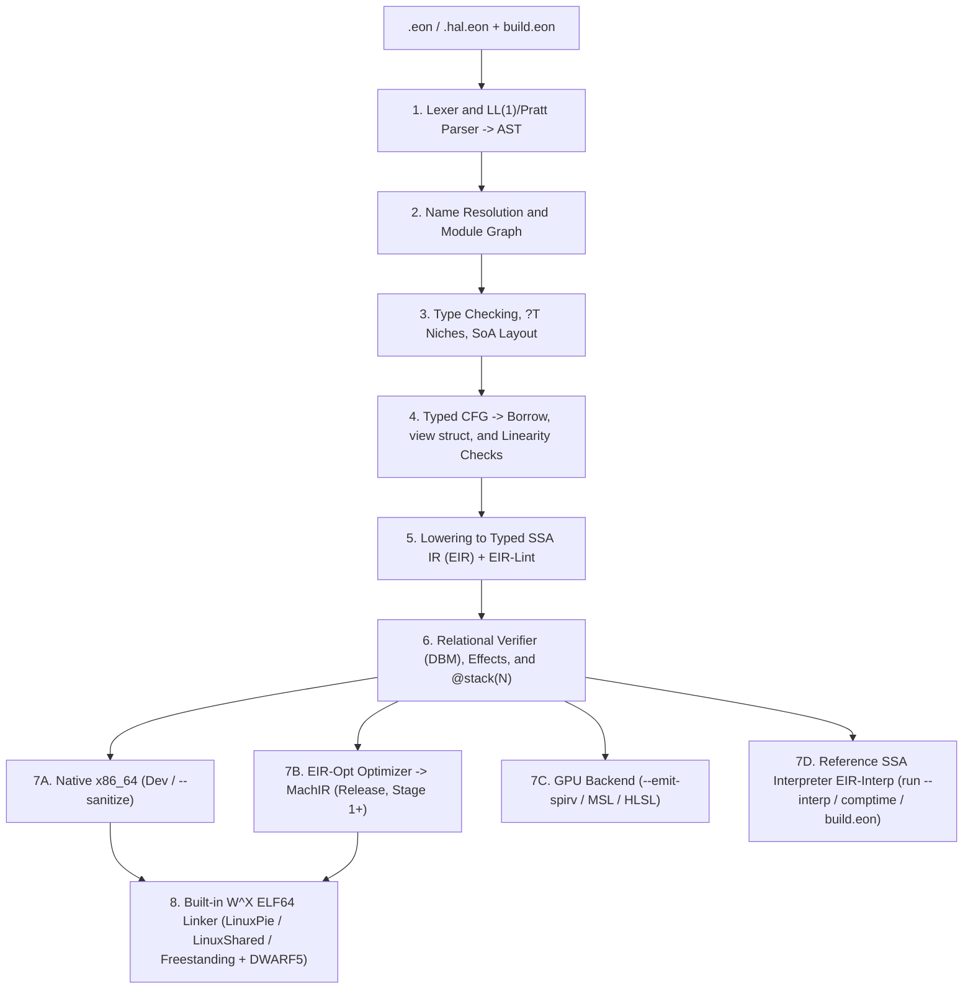
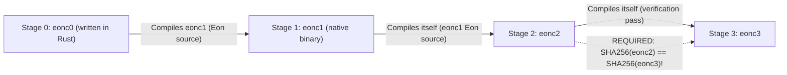

# 10. Compiler Architecture, `EIR`, Backends, and the Self-Hosting Protocol

This chapter describes the target `eonc` pipeline from source checking through code generation, memory sanitization, the `libc`-free system runtime, debugging, and reproducible bootstrapping. Compiling and running programs on Linux `x86_64` operates completely without a C compiler (`clang`/`gcc`), external linker (`ld`), or `libc`/`libm`.

---

## 1. Overall Compiler Pipeline (`eonc`)

The frontend resolves names and types, then lowers each function body into a typed control-flow graph (CFG). The graph records local value identifiers, resolved operations, and source locations for diagnostics. Normal and error exits, loop edges, and the execution order of `defer` and `errdefer` are represented by explicit edges and blocks. Borrow provenance checking and linear resource state tracking run on this graph. After those checks pass, SSA lowering transfers the established properties into `EIR` for the verifier, interpreter, and native backends.



### 1.1. Compiler Target Budgets
* **RAM usage:** `< 100 MB` for a 100,000-line project. Key levers for keeping memory low are compact node tables, string interning, and releasing scratch memory after each function is processed.
* **Full rebuild throughput (Dev profile):** `>= 200,000 lines/sec` on a 4-core CPU (parallel parsing, verification, and code generation across modules and functions).
* **Incremental single-function edit latency:** `1–5 ms` (including updating the `.eobj` cache and Hot-Reload).

---

## 2. `EIR` Intermediate Representation (Eon Intermediate Representation)

**`EIR`** is a typed SSA representation that preserves source-operation properties and static verification results all the way through code generation:
* **High-level properties preserved in `EIR`:**
  - `noalias` facts wherever access-path analysis proved disjoint borrows or distinct `pool` columns.
  - Annotated **proven value ranges (`ValueRange`)** on SSA nodes (enabling the backend to eliminate dead branches, narrow 64-bit operations to 32-bit, and drop sign extensions).
  - Explicit `PoolColumnLoad` / `PoolColumnStore` and `ParFor` nodes (allowing the vectorizer to emit dense `vmovaps`/`ld1`/`vle32.v` directly without guessing about aliasing!).
  - Explicit `CheckedCall` instruction (returning errors in the dedicated register + `CF` flag).
  - `LayoutKey(size, align)` boundary annotations for `Layout Sharing`.
* **In-memory representation:** a single flat array of 16-byte instructions in a per-function arena (0 per-node allocations, L1 cache locality).

### 2.1. Core `EIR` Instruction Set (Minimal Kernel for `Stage 0` and `Stage 1`)

| Group | `EIR` Instructions | Semantic Guarantees for the Backend |
| :--- | :--- | :--- |
| **Constants & SSA** | `ConstInt`, `ConstFloat`, `ConstZero`, `Param`, `BlockParam` (alternative to `Phi`) | Basic-block parameters (as in Cranelift/MLIR) simplify `FastISel` and `EIR-Opt`. |
| **Proven Arithmetic** | `AddNoOv`, `SubNoOv`, `MulNoOv`, `DivNoZero`, `ShlBound`, `ShrBound` | Guaranteed overflow-free (`nsw`/`nuw` by construction!). |
| **Explicit Arithmetic & Intrinsics** | `AddWrap`, `AddSat`, `AddChecked`, `FAdd`, `FMul`, `Fma`, `@sqrt`, `@fma`, `@lzcnt`, `@tzcnt`, `@popcnt`, `@bswap`, `BitAnd`, `BitOr`, `BitXor` | `AddChecked` produces a `(val, overflow_flag)` pair from `OF`/`CF`; math/bit intrinsics (`MathSqrt`, `MathFma`, `MathLzcnt`, `MathTzcnt`, `MathPopcnt`, `MathBswap`) map directly to `sqrtsd`/`vfmadd213`/`lzcnt`/`tzcnt`/`popcnt`/`bswap`. |
| **SIMD** | `VecSplat`, `VecOp`, `VecShuffle`, `VecLoadAligned`, `VecStoreAligned` | Map 1-to-1 to SSE2/AVX2 / NEON / RVV / SPIR-V. |
| **Memory & Pools** | `StackSlot`, `FieldAddr`, `PoolColAddr`, `Load`, `Store`, `MemCopyExplicit` | All `PoolColAddr` nodes for distinct columns are marked pairwise `noalias`. |
| **Calls & Errors** | `CallEon`, `CallExternC`, `CallDyn`, `RetVal`, `RetErr`, `BranchOnErr` | `BranchOnErr` tests the `CF` flag / `r15` register in 1 instruction. |
| **Control Flow** | `Jump`, `Branch`, `Switch`, `TrapUnreachable` | `TrapUnreachable` is permitted only after the DBM proves unreachability (empty domain). |
| **Concurrency & HAL** | `ParForChunk`, `AtomicLoad`, `AtomicStore`, `AtomicRmw`, `AtomicCas`, `Fence`, `DmaFence`, `MmioLoad`, `MmioStore`, `InlineAsm` | Exact barrier mapping onto x86_64/ARM64/RISC-V. |
| **GPU** | `GpuGlobalId`, `GpuLocalId`, `GpuBarrier`, `GpuBufLoad`, `GpuImageStore` | Validated only inside functions marked `@gpu`. |

---

## 3. Zero-C Dual-Backend Architecture, Sanitizer, and Runtime (`core/` vs `std/`)

The shared typed SSA `EIR` (validated by the `EIR-Lint` pass: strict SSA, types, and no uninitialized values) drives **two completely self-contained CPU backends with zero involvement of `clang`, `gcc`, external `ld`, or `libc`/`libm`**:
1. **Native `x86_64` backend + built-in W^X `ELF64` linker** (`eonc build`, `eonc run`, `--shared`, `--freestanding`, `--sanitize`).
2. **Reference SSA interpreter `EIR-Interp`** (`eonc run --interp`, the `comptime` VM, and the isolated `build.eon` sandbox).

### 3.1. Native `Dev` Profile (`x86_64`)
* **Passes:** 0 heavy optimizations; fast lowering `EIR -> x86_64` (in `Stage 1+` via a unified `MachIR` layer + Linear-Scan RegAlloc; ~8,000–12,000 lines per architecture).
* **Self-sufficiency without `libc`:** all required system helpers (TLS slab allocator, `vDSO` parser, `openat2`, `clone`/`futex` scheduler, `eon_fiber_switch`, and `io_uring`) are assembled on demand by the compiler and linked directly by the `ELF64` linker.
* **Debugging and loading:** emits **DWARF5** tables (`.debug_info` / `.debug_line`) for Linux (with PDB / Mach-O / Hot-Reload on the subsequent roadmap).

### 3.2. `Release` Profile (`EIR-Opt` — Maximum Performance)
A custom, compact, yet aggressive SSA optimizer tailored specifically to Eon's strengths (roughly 25,000–40,000 lines of pure Eon in `Stage 1+`):
1. **Inlining and interprocedural constant propagation** (respecting `@inline`/`@hot`/`@cold` and the `L1i` cache budget).
2. **SROA (Scalar Replacement of Aggregates)** and decomposing `SoA` operations into registers.
3. **GVN (Global Value Numbering), LICM (Loop-Invariant Code Motion), Strength Reduction, and Tail-Call Optimization.**
4. **Loop Vectorization (SLP + Loop Vectorization):** leverages proven disjointness of columns and elementwise accesses.
5. **IPRA (Interprocedural Register Allocation):** for module-private functions, the compiler departs from the ABI and keeps values live in registers directly across call boundaries.
6. **Graph/SSA register allocation + Instruction Scheduling** targeting specific microarchitectures (`x86_64-v3/v4`, `ARM64 Neoverse/Apple-M`, `RV64GC+V`).
7. **Whole-Program Layout Sharing + Dead Code Elimination** prior to the built-in linker.

### 3.3. Reference SSA Interpreter `EIR-Interp` (`eonc run --interp`)
* **Zero-C11 semantic oracle:** in Phase 6, the temporary C11 backend (`--emit-c`) and invocations of `clang`/`cc` were completely removed. `EIR-Interp` executes SSA `EIR` directly with exact checking of memory bounds, slot lifetimes, alignment, `union`/`?T` tags, linear obligations, and arithmetic overflows — eliminating any inheritance of C Undefined Behavior.
* **Three roles in the pipeline:**
  1. `eonc run --interp` — reference execution of programs and differential verification (`EIR-Interp == x86_64 == x86_64 --sanitize`).
  2. Execution of `comptime` blocks with a deterministic step limit (fuel).
  3. Isolated execution of the `build.eon` build script holding `*mut BuildCap` (see §4.2).

### 3.4. Built-in Memory Sanitizer (`--sanitize`)
The `eonc build --sanitize` flag (as well as `build.set_sanitize(true)` in `build.eon`) replaces external ASan/UBSan with a hardware-accelerated memory diagnostics mode directly inside the native binary:
* **Guard Pages (`PROT_NONE`):** every allocated buffer is placed flush against an unreadable `PROT_NONE` page (`eon_alloc_raw_san`), so even a 1-byte out-of-bounds access (including inside `.hal.eon` / `raw`) triggers an immediate hardware `SIGSEGV`.
* **`0xDE` Poisoning and 64-Slot Quarantine:** upon free (`eon_free_raw_san`) or arena reset (`eon_rt_arena_reset_san`), the memory region is overwritten with poison byte `0xDE`; freed pages are switched to `PROT_NONE` and placed into a **64-slot quarantine ring** (avoiding unbounded VMA growth), immediately catching Use-After-Free.
* **Alignment Traps:** verifies required alignment on pointer operations and allocations, halting immediately via hardware trap upon misalignment.
* **Fiber Stack Guard Pages:** in sanitizer mode, a `PROT_NONE` guard page is attached to every static fiber stack (`@stack(N)` stack overflow is caught in hardware with zero checks in function prologues).
* **`sigaltstack` Signal Handler + DWARF Backtrace:** at process startup, a dedicated signal stack (`SYS_sigaltstack`, 16 KB `__eon_san_altstack`) is configured and a `SYS_rt_sigaction` handler (`SA_ONSTACK | SA_SIGINFO`) is registered for `SIGSEGV`, `SIGILL`, and `SIGBUS`, printing the signal number, faulting address (`si_addr`), `RIP`, and a stack frame backtrace resolvable against DWARF5 sections (`.debug_info` / `.debug_line`).

### 3.5. Zero-`libc` Runtime, `Env` Capabilities, and `core/` vs `std/` Architecture

#### `_start` Initialization and `Env` Capabilities
The `glibc`-free `_start` entry stub parses the initial Linux kernel stack frame (`argc`, `argv`, `envp`, and the `auxv` vector: `AT_PAGESZ`, `AT_RANDOM`, `AT_SYSINFO_EHDR`), configures main-thread TLS (`FS.base` via `SYS_arch_prctl(ARCH_SET_FS)`), and passes the root capabilities into `pub fn main(env: *mut Env)`:
* **`env.alloc: AllocCap`** — root allocator (fast per-thread TLS slab freelists for `8..2048 B` without atomics, bitmap-tracked medium spans, and large allocations via `mmap`/`munmap`), supporting hierarchical memory quotas via **`alloc.sub_budget(bytes)`** (`OutOfMemory` on exhaustion).
* **`env.fs: FsCap` and `DirCap`** — root filesystem capability (`open_dir` / `sub_dir`, `read_file`, `write_file`). Scoped directory capabilities `DirCap` on Linux rely on **`SYS_openat2` with `RESOLVE_BENEATH`**, kernel-enforcing containment so traversal outside the root via `..` or symlinks is blocked at the syscall layer.
* **`env.net: NetCap`** — networking capability with host/port narrowing via `restrict_host(...)`.
* **`env.clock: ClockCap`** — monotonic nanosecond clock (`clock.now_ns()`), resolving `__vdso_clock_gettime` directly from the in-memory Linux **`vDSO`** image (via `AT_SYSINFO_EHDR`): userspace time reads take **`< 10 ns`** (typically ~3 ns) with no kernel transition and no `libc`.
* **`env.io: IoCap`** — copyable I/O and scheduler handle backed by **`SYS_io_uring_setup` / `SYS_io_uring_enter`**, static fiber switching (`eon_fiber_switch`), and a "1 thread = 1 core" multicore pool (`clone` / `sched_setaffinity` / `futex` / `WorkDeque`).
* **`env.args: ArgsCap`** — safe access to command-line arguments (`.len()`, `.get(i)`).

#### The `core/` (Freestanding) vs `std/` (OS Runtime) Boundary
* **`core/` — strict freestanding layer (0 syscalls, suitable for OS kernels and `eonc1`):**
  - `core/math.eon` — wrappers for hardware intrinsics **`@sqrt`**, **`@fma`**, **`@lzcnt`**, **`@tzcnt`**, **`@popcnt`**, **`@bswap`** and deterministic pure-Eon implementations (`exp`, `log`, `sin`, `cos`, `tan`, `atan`, `atan2`, `pow`) accurate to **`<= 1 ULP`** with zero `libm` dependency.
  - `core/col.eon` — freestanding linear data structures: SwissTable-style **`HashMap[V]`** with SIMD probing of 16-byte tag groups on **`u8x16`**, **`BitSet`**, and a deterministic **`Interner`**.
  - `core/mem.eon` (`FrameArena`, `SlotPool`, `Buf`, `LinearBuf`, `copy_slice`), `core/str.eon` (UTF-8 validation, `StrBuf`, number parsing), `core/io.eon` (`IoRing`, `IoSqe`/`IoCqe`, `FiberContext`), `core/sync.hal.eon` (`AtomicCounter`, `SpinLock`, `WorkDeque`), `core/hal.hal.eon` (`PhysAddr`/`VirtAddr`, DMA/MMIO barriers).
* **`std/` — Linux `x86_64` system runtime layered over `Capabilities` and `.hal.eon`:**
  - `std/rt.hal.eon` — basic output, `ClockCap` (`vDSO`), `ArgsCap`, `FsCap`/`DirCap` (`SYS_openat2(RESOLVE_BENEATH)`), and UTF-8 helpers.
  - `std/alloc.hal.eon` — `AllocCap` introspection and quotas (`sub_budget`, `live_allocs`, `used_bytes`, `peak_bytes`).
  - `std/sched.hal.eon` — running static fibers over `io_uring` (`run_fibers`, `iouring_nop_batch`), initializing `WorkDeque` and `IoRing`, `cpu_pause`.

---

## 4. Built-in W^X `ELF64` Linker, `build.eon`, TCB Audit, Debugging (DWARF/PDB), and LSP

### 4.1. Built-in W^X `ELF64` Linker and `ElfMode` Variants
`eonc` contains built-in object and executable emitters **without any external `ld`/`lld`/`clang`/`gcc`**:
* **`ELF64` (Linux `x86_64` and bare-metal):** strict **W^X** segment separation (`PT_LOAD` `R|X` for `.text`, `R` for `.rodata`, `R|W` for `.data`/`.bss`, `PT_GNU_RELRO`, non-executable `PT_GNU_STACK`), native **`PT_TLS`** support (`.tdata`/`.tbss` and `fs:` `TpOff32` offsets), dynamic linking against external system `.so` libraries for `extern "C"` (`PT_INTERP`, `.dynamic`, `.dynsym`, `.gnu.hash`, `.rela.dyn`, `PLT/GOT`), and three `ElfMode` targets:
  1. **`ElfMode::LinuxPie` (default for `eonc build`):** position-independent executable (`ET_DYN` PIE) with `R_X86_64_RELATIVE` (`DT_RELACOUNT`) relocations for ASLR support.
  2. **`ElfMode::LinuxShared` (`eonc build --shared`):** shared library (`ET_DYN` `.so`) with `DT_SONAME` and exported symbols.
  3. **`ElfMode::Freestanding` (`eonc build --freestanding`):** bootable bare-metal `ELF64` image for OS kernels (fixed `load_addr`, optional Multiboot2 header).
* Formats for subsequent roadmap milestones: `EonBin` (EonOS), `PE/COFF` (Windows), `Mach-O` (macOS/iOS).

Core CLI commands (zero C-toolchain dependencies):
```
eonc build examples/layout_proto -o layout_proto      # ElfMode::LinuxPie (ET_DYN PIE by default)
eonc build --shared src/plugin.eon -o libplugin.so    # ElfMode::LinuxShared (.so)
eonc build --freestanding kernel/main.eon -o kernel   # ElfMode::Freestanding
eonc build --sanitize examples/layout_proto -o out    # Built-in memory sanitizer
eonc build --audit-tcb examples/layout_proto          # TCB audit (SHA-256 + raw/asm/extern "C")
eonc run examples/layout_proto                        # Build and run natively
eonc run --interp examples/layout_proto               # Run in reference EIR-Interp
```
*(Cross-compilation target flags `eon build --target=...` for Windows/EonOS/RISC-V/ARM64 unlock in the multi-platform milestone on top of the same built-in linker.)*

### 4.2. `build.eon` Sandbox (`BuildCap`) and TCB Audit (`--audit-tcb`)
* **`build.eon` sandbox:** the `build.eon` build script is compiled strictly in the `FileProfile::Safe` profile (`@hal`, `.hal.eon`, `raw { ... }`, `asm(...)`, and `extern "C"` are forbidden), takes `*mut BuildCap` as its sole parameter, and executes inside `EIR-Interp`. All target and output directory paths are validated to remain strictly within the package root (absolute paths, `..`, NUL bytes, and symlink escapes are rejected). Available `BuildCap` methods: `add_module`, `add_exe`, `add_shared_lib`/`add_shared`, `set_out_dir`, `set_sanitize`, `set_audit_tcb`, `set_opt_level`, `link_lib`/`add_needed_lib`, `allow_hal`, `out_path`.
* **TCB Audit (`eonc build --audit-tcb`):** scans every `@hal` and `.hal.eon` compilation unit, computes each file's cryptographic **FIPS 180-4 SHA-256** digest, counts the exact number of lines inside `raw { ... }`, the number of `asm(...)` sites, and all `extern "C"` imports, and verifies that every module matches the `allow_hal` allowlist in `build.eon`.

### 4.3. Debug Information and Profiling
* The built-in `ELF64` linker directly emits standard **DWARF5** tables (`.debug_info`, `.debug_abbrev`, `.debug_line`) compatible with `gdb`, `lldb`, `readelf -wl`, `perf`, `RenderDoc`, and `Tracy` (including `--sanitize` fault addresses; CodeView/PDB for the target PE backend).
* A dedicated debug section projects SoA `pool` columns as convenient logical objects in the debugger (the programmer inspects `widget[5] = { pos, size, color }` rather than 5 scattered arrays!).

### 4.4. Built-in LSP (`eon lsp`) — Critical for the Relational Analyzer
Because the Eon compiler is strict ("Zero-Mercy") and demands range proofs:
* `eon lsp` runs directly on top of the exact same incremental compiler query graph (0 duplicated logic).
* **Interval Inlays:** hovering over any variable or index immediately displays the inferred DBM fact (e.g., `i: usize [0..=n-1], i < buf.len`), and on `E0107` / `E0108` errors the LSP offers quick-fixes (insert an `if` guard, add a `where` clause, replace `+` with `+%` / `+|`, or replace `buf[i]` with `try buf.at(i)`).
* **Stack usage hints:** on every function, the LSP displays its computed `@stack(N)` ceiling and inferred effects.

---

## 5. Formal Bootstrap and Self-Hosting Protocol (`Stage 0 -> Stage 2`)

The transition to self-hosting is strictly governed to avoid the "premature rewrite trap" (the lesson of early Rust) and to guarantee cryptographic purity of the build chain:



### Stage Transition Criteria

1. **Stage 0 (`eonc0`, implementation language: Rust):**
   - Implements the **complete core of the Eon v0.2 specification** (lexer, parser, types, Second-Class Borrows, `view struct`, `?T` niches, `linear` + `errdefer`, DBM verifier, SoA `pool`, `comptime` VM, effects, `@hal`, `EIR`, reference interpreter `EIR-Interp` + direct native `x86_64` backend and built-in W^X `ELF64` linker with zero C11 and zero `libc`).
   - **Stage 0 Exit Gate (Design Freeze Gate):** advancing to Stage 1 is **forbidden** until two real-world validation projects are written, built, and tested on `eonc0`:
     1. A bootable EonOS microkernel in QEMU (`x86_64`: timer interrupts, PMM with `linear PhysPage`, MMIO UART/APIC, `@noalloc @stack`).
     2. A cross-platform UI window with `ArenaPool[Widget]`, `SlotPool`, `sys`/`par for`, and `@gpu` rendering (Vulkan/SPIR-V) on Linux/Windows.
   - Any syntax or DBM rough edges surfaced by those two projects are fixed in `spec/` and `eonc0` (rapidly, without bootstrap friction), after which the specification is frozen as **`Eon v1.0-freeze`**.

2. **Stage 1 (`eonc1`, implementation language: pure Eon, 0% Rust):**
   - Written from scratch in Eon using all of the language's strengths: SoA `ArenaPool` for AST/EIR, `par for` for parallel module checking, `linear` for file descriptors and buffers, `0` panics, and a minimal `@hal` layer for OS I/O.
   - Compiled by `eonc0` and passes **100% of the exact same test suite** (thousands of positive and negative Zero-Mercy tests) as `eonc0`.

3. **Stage 2 & Stage 3 (Triple Bootstrap and Reproducibility):**
   - `eonc1` compiles its own source code -> producing **`eonc2`**.
   - `eonc2` compiles the exact same source code once more -> producing **`eonc3`**.
   - **Self-Hosting Success Criterion:** **`SHA-256(eonc2) == SHA-256(eonc3)`** (bit-for-bit executable identity!).
   - Once `Stage 2 == Stage 3` is confirmed:
     - The `Stage 0` (Rust) codebase **remains in the repository as the Bootstrap Seed**: Rust is available on all target platforms, so `eonc` can always be built from scratch via the chain `eonc0 (Rust) -> eonc1 -> eonc2` without trusting prebuilt Eon binaries (defending against Ken Thompson's "Trusting Trust" attack). To preserve this property, `eonc0` must maintain support for the compiler subset of the language in which `eonc1` is written.
     - No C snapshot `bootstrap/seed.c` is used: in Phase 6, the C11 backend and `--emit-c` flag were completely removed; the built-in SSA interpreter `EIR-Interp` serves as the semantic reference (see [ROADMAP.md](../ROADMAP.md), Phase 6).

---

## 6. Master Error Code Registry (Prefixes)

| Range | Compiler Subsystem |
| :--- | :--- |
| `E0001–E0099` | Lexer, UTF-8, Trojan Source, syntax, LL(1)/Pratt |
| `E0101–E0199` | Zero-Mercy rules (`ZM-01`..`ZM-18`), modules, cyclic imports. Exception: `ZM-06` is diagnosed as `E0301` (`E0106` is reserved). `ZM-07` / `ZM-08` (`E0107` / `E0108`) are emitted by the verifier in pipeline stage 6 |
| `E0201–E0299` | Type system, literals, `bitfield`, `@packed`, memory layout |
| `E0301–E0399` | Moves (>16 B, including `ZM-06`), Second-Class Borrows, borrowed values (`E0311`), `linear`, `errdefer`, `Id[p]` brands (`E0330`–`E0332`) |
| `E0401–E0499` | Relational analyzer (DBM, `@analysis(N)` level), `where` / `ensures` contracts, arithmetic, `! E` errors |
| `E0501–E0599` | Generics, `iface`/`impl`, `@stack` budget, `comptime` VM |
| `E0601–E0699` | `sys` conflict graph, `par for`, atomics, and memory model |
| `E0701–E0799` | Effects (`@noalloc`, `@noblock`, `@interrupt`), Capabilities, fibers |
| `E0801–E0899` | `@hal` boundaries, MMIO, `extern "C"`, `@gpu` (`std430`, SIMT barriers) |
| `E0901–E0999` | ABI, `.emi` interfaces, linker, Hot-Reload schema incompatibility |
